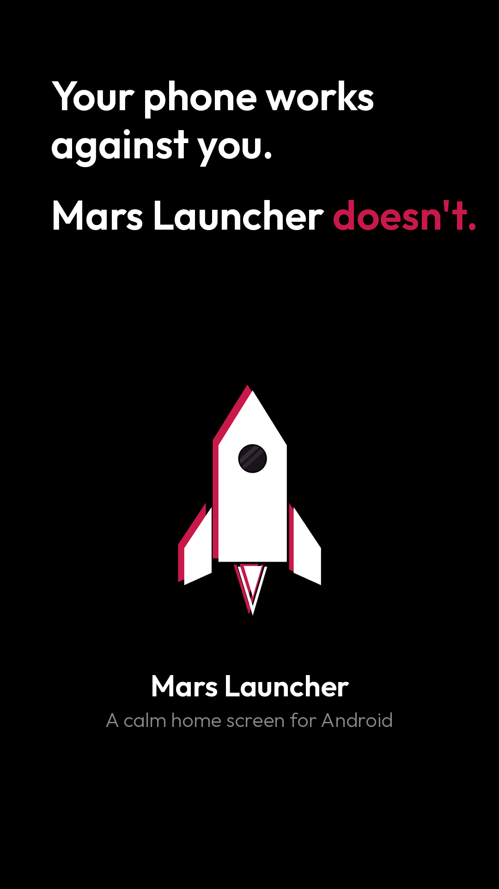
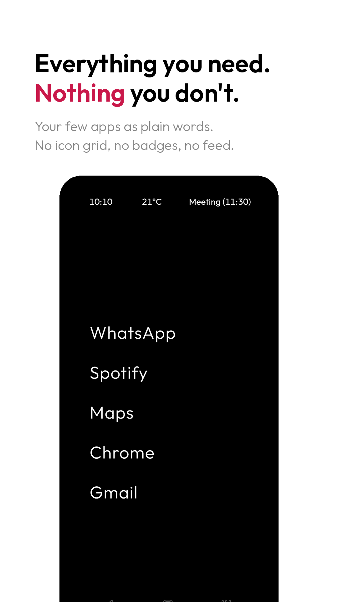
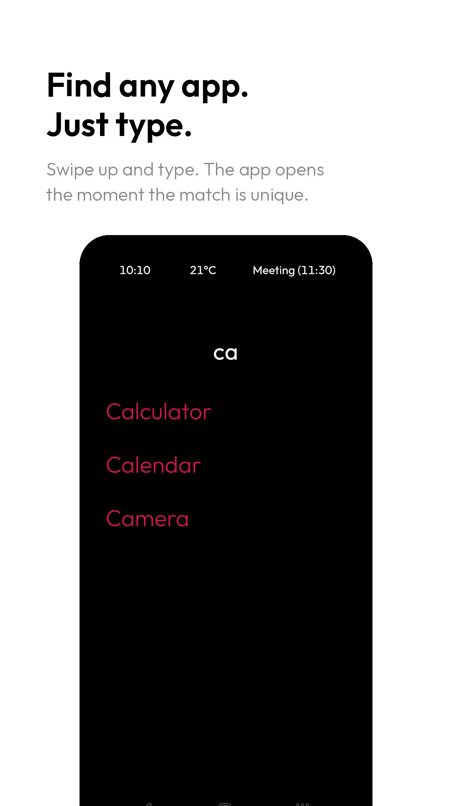
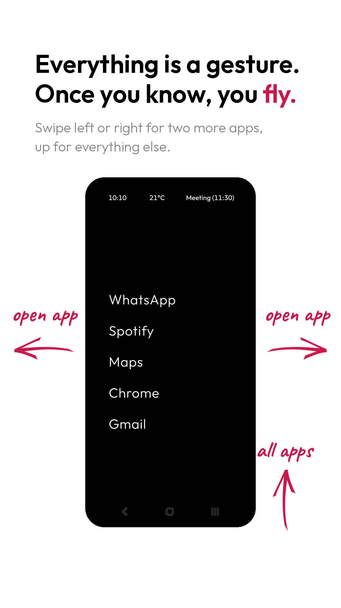
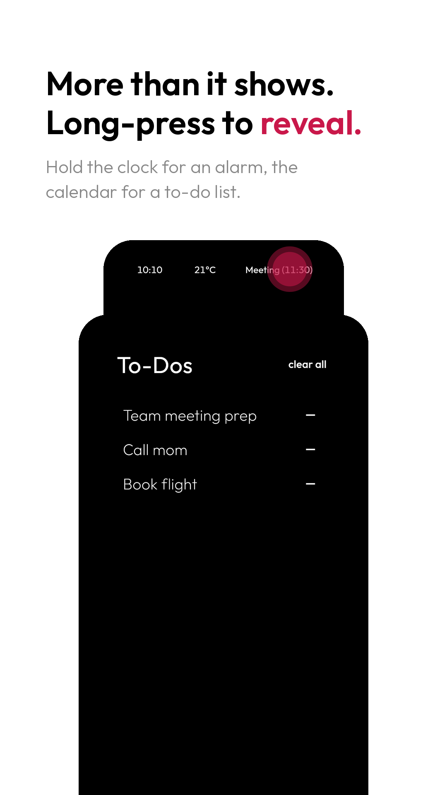

# Mars Launcher

[](https://play.google.com/store/apps/details?id=com.cloudcatcher.mars_launcher)

A home screen for Android that gets out of your way. No icon grid, no badges, no colour. Just a short list of the apps you actually use, and gestures for the rest.

I couldn't switch to a dumb phone, but I wanted mine to feel like one. This is the launcher I built for that, and I use it every day.

<p>
  
  
  
  
  
</p>

## What it does

- **Text-only home screen.** Up to seven shortcuts as plain words. Tap to open, hold to reassign. Rename them if you like ("Social" instead of "Instagram").
- **Swipe up and type.** The app opens as soon as your search is unique. No extra tap.
- **Swipe left or right** for two more shortcuts.
- **Swipe down** for the other Mars apps.
- **Top row instead of a status bar:** clock, battery, weather, next calendar event. Each one opens the app you link to it. Hold the clock for a quick alarm, the calendar for a to-do list, the weather for sunrise and sunset.
- **Double tap** switches between dark and light. **Long press** opens settings.

Weather comes from [Open-Meteo](https://open-meteo.com/), which needs no key and no account. Everything else stays on the device. No ads, no tracking, no analytics.

## Build

You need the [Flutter SDK](https://docs.flutter.dev/get-started/install) and an Android device or emulator.

```bash
git clone https://github.com/libaum/mars-launcher.git
cd mars-launcher
flutter pub get
flutter run
```

`./install_release.sh` builds a release APK and installs it next to the debug build.

## Under the hood

Flutter and Dart. State is plain `ValueNotifier`s held by manager classes, wired up with GetIt. Settings and to-dos live in SharedPreferences. See [CLAUDE.md](CLAUDE.md) for the architecture.

## License

MIT, see [LICENSE](LICENSE).
